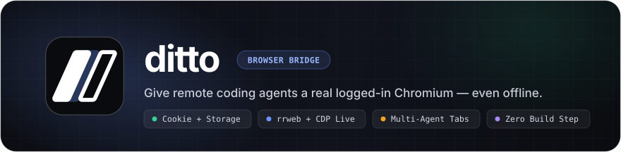
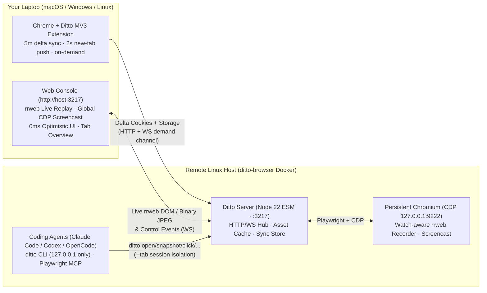

<p align="center">
  
</p>

<p align="center">
  <strong>Give your remote Linux coding agents a real logged-in Chromium — even when your laptop is asleep.</strong>
</p>

<p align="center">
  <a href="./README.md"><strong>English</strong></a> · <a href="./README.zh-CN.md">简体中文</a>
</p>

<p align="center">
  <a href="https://github.com/zonghow/ditto/actions/workflows/ci.yml"></a>
  = 22" />
  
  
  
  <a href="./LICENSE"></a>
</p>

---

## Why Ditto?

When running coding agents (**Claude Code**, **Codex**, **OpenCode**, etc.) on a headless Linux devbox or cloud VM, browser tasks usually break down in one of two ways:

- **Headless browsers start logged out** — they can't access internal dashboards, PR reviews, staging consoles, or SSO-protected apps.
- **Forwarding your laptop's live Chrome steals focus and dies on sleep** — closing your laptop lid kills every agent browser workflow.

**Ditto** bridges the gap: it runs a dedicated persistent Chromium inside Docker on your remote Linux host, silently syncs your real Chrome login state (Cookies + `localStorage` / `sessionStorage`) via a zero-build MV3 extension with SHA-256 delta deduplication, exposes a multi-agent-safe CLI & Skill (`ditto`), and streams an interactive Chrome-like Web Console (`rrweb` live DOM replay + global CDP screencast) whenever you want to watch, intervene, or solve a CAPTCHA.

| Capability | **Ditto** | Local Chrome MCP / Relay | Plain Headless Playwright | noVNC / Remote Desktop |
| --- | :---: | :---: | :---: | :---: |
| Works after laptop sleeps / goes offline | **Yes** | No | Yes | Yes |
| Reuses your real Chrome login state | **Yes** | Yes | No | Manual login |
| Never steals your laptop window focus | **Yes** | No | Yes | Yes |
| Multi-agent concurrent tab isolation (`--tab`) | **Yes** | No | Manual | No |
| Lightweight live DOM replay (`~0.3 KB/s` idle) | **Yes** | N/A | No | No (heavy video) |
| Global CDP screencast for CAPTCHAs & cross-origin iframes | **Yes** | Yes | No | Yes |
| Zero build step (Node 22 ESM + native browser ESM) | **Yes** | Varies | Varies | No |

---

## Architecture



---

## Highlights

- **Offline-Resilient Login State Sync**
  - Initial full-profile Cookie + open-tab Storage sync on connect, **5-minute SHA-256 delta sync**, **2-second proactive push** whenever you open a new tab on your laptop, plus instant on-demand `ditto sync`.
  - Preserves `HttpOnly`, `Secure`, `SameSite`, expiry, host-only boundaries, and partition keys. Even after your laptop closes, your remote Chromium profile stays logged in.
- **Multi-Agent Safe `ditto` CLI & Skill**
  - Zero-dependency CLI (`~/.local/bin/ditto`) and pre-packaged `SKILL.md` (auto-linked for Claude Code, Codex, and OpenCode).
  - Enforces per-session tab isolation (`--tab <shortId>`) with automatic session binding so parallel agents never clobber each other's tabs or steal viewer focus.
  - Supports Shadow DOM & same-origin iframe snapshots (`@e1`, `@e2` refs), clicks, fills, selects, scroll, file upload, native dialogs, console/network diagnostics, JS eval, and screenshots.
- **Ultra-Low-Latency Web Console**
  - **Chrome-like Shell**: Horizontal or vertical tab strip synced to real CDP tab order, adaptive full-viewport tab overview wall (click the top-left Ditto logo to toggle instantly), right-click tab context menu, address bar with local + Chrome history autocomplete.
  - **0ms Optimistic UI**: Instant local scrolling (with settle-aware reconciliation), instant tab open/close with `beforeunload` rollback, optimistic native form controls (checkbox, radio, `<select>`, `<details>`), tactile `:active` press feedback, and 0ms server event flushing during user interaction.
  - **Right-Side Settings Drawer** (⚙ icon at top-right): View mode, tab layout, light/dark/system theme, adaptive vs 1080p viewport, **Global Direct Screencast** switch, active Agent follow pinning, live per-process PSS memory monitor, and remote download retrieval.
- **Global Direct Screencast Mode (CDP)**
  - Toggle **Direct Screencast** once in the right-side drawer to stream binary JPEG frames (`createImageBitmap` off-main-thread decode + backpressure frame dropping) globally across all tabs.
  - Seamlessly handles cross-origin SSO iframes, Canvas CAPTCHAs, and slider drags, automatically pausing `rrweb` recording while streaming to save CPU.
- **Security by Design**
  - Inert `rrweb` replay sandbox (`sandbox="allow-same-origin"`, **never** `allow-scripts`), server-side script stripping, strict CSP, password masking, `[data-ditto-private]` redaction, and loopback-only `/api/agent/*` protection. See [SECURITY.md](./SECURITY.md).

---

## Quick Start (3 Steps)

### Step 1 — Load the Chrome Extension on Your Laptop

1. Open `chrome://extensions/` in Chrome on your daily driver.
2. Enable **Developer mode** (top right) and click **Load unpacked**.
3. Select the **`extension/`** directory from this repo (no build required) and keep site access enabled.

### Step 2 — Deploy Ditto on Your Remote Linux Host

#### Option A: One-Prompt Agent Setup (Recommended)

Send this prompt directly to your Coding Agent (**Claude Code**, **Codex**, or **OpenCode**) running on your remote Linux machine:

```text
Clone https://github.com/zonghow/ditto.git to ~/ditto (if not already cloned), then follow ~/ditto/INSTALL.md to start Ditto via Docker, install the ditto CLI and browser skill, verify /health, and reply with the reachable http://<host-ip>:3217 URL.
```

#### Option B: Manual Docker Setup

```bash
git clone https://github.com/zonghow/ditto.git
cd ditto
sh scripts/docker-up.sh        # Builds & starts ditto-browser on :3217
sh scripts/install-skill.sh    # Installs ~/.local/bin/ditto & Agent Skill
ditto status                   # Verify Chromium is ready
```

> Using a slow network? Pass custom mirrors:
> `DITTO_APT_MIRROR=http://mirrors.tuna.tsinghua.edu.cn DITTO_NPM_REGISTRY=https://registry.npmmirror.com sh scripts/docker-up.sh`
>
> For SSH-tunnel-only hosts, `DITTO_AUTH=1`, legacy Docker 18, Playwright MCP, or CookieCloud setup, see [docs/deployment.md](./docs/deployment.md).

### Step 3 — Connect the Extension

1. Click the **Ditto** icon in Chrome on your laptop, enter `http://<host-ip>:3217`, and click **Connect** (`连接`).
2. Full-profile delta sync starts immediately in the background.
3. Click **Open Console ↗** (`观测页 ↗`) — or visit `http://<host-ip>:3217` — anytime to watch your agents live or interact directly with the remote browser.

---

## `ditto` CLI Cheat Sheet

Full agent workflow specification: [skills/ditto/SKILL.md](./skills/ditto/SKILL.md).

```bash
# Open an isolated tab for this agent session (auto-syncs login state if extension is online)
ditto open "https://example.com"          # -> returns shortId, e.g. e28c2282

# Inspect & interact (pass --tab <shortId> for multi-agent concurrency safety)
ditto snapshot --tab e28c2282             # Text + interactive refs (@e1, @e2...) incl. Shadow DOM & iframes
ditto click @e1 --tab e28c2282            # Click by ref or Playwright selector
ditto fill @e2 "hello" --tab e28c2282     # Fill input / textarea
ditto select @e3 "opt" --tab e28c2282     # Select dropdown option
ditto press Enter --tab e28c2282          # Dispatch keyboard key
ditto scroll down --tab e28c2282          # Scroll page or specific container (--target)
ditto upload @e4 /path/file.png --tab e28c2282
ditto wait --text "Done" --tab e28c2282   # Wait for selector / text / URL / --networkidle

# Debug & handle dialogs (leave tabs open by default so users can inspect/continue in the console)
ditto dialog accept --tab e28c2282        # Accept / dismiss alert, confirm, prompt
ditto console --tab e28c2282              # Recent console logs & uncaught page errors
ditto network --tab e28c2282              # Failed HTTP requests (--all for every request)
ditto eval "document.title" --tab e28c2282
ditto sync --tab e28c2282                 # Force re-sync fresh login state from laptop & reload
ditto screenshot /tmp/page.png --tab e28c2282
# ditto close --tab e28c2282              # Only close when explicitly asked or cleaning up temp tabs
```

---

## Project Structure

```text
Ditto/
├── src/                  # Node.js 22 ESM server (Express + ws + Playwright + CDP)
│   ├── main.js           # Entry point & graceful shutdown
│   ├── app.js            # HTTP routes, static ETag caching & middleware
│   ├── ws-hub.js         # Live viewer & extension WebSocket hubs, binary screencast
│   ├── browser*.js       # Persistent Chromium, CDP control, watch-aware recording, tabs
│   ├── recorder*.js      # Page-injected rrweb 2.2 recorder & strict DOM sanitizer
│   ├── screencast.js     # CDP Page.startScreencast session manager
│   ├── import-snapshot.js# SHA-256 delta Cookie & Storage importer
│   └── routes/           # /api/agent/* (loopback-guarded) & /api/sync/* routes
├── public/               # Zero-build browser ESM Web Console (tabs, overview, replay, drawer)
├── extension/            # Chrome MV3 extension (delta periodic sync + new-tab push)
├── scripts/              # Zero-dependency `ditto` CLI, Docker & SSH deployment scripts
├── skills/ditto/         # Ready-to-install Coding Agent SKILL.md
├── deploy/               # Legacy Docker 18 Dockerfile, installer & seccomp profile
├── docs/                 # Deployment guide & visual assets
└── test/                 # 99 unit tests + real Chromium, attach & MV3 extension suites
```

---

## Development & Testing

Requires **Node.js 22+**.

```bash
npm ci --ignore-scripts
npx playwright install chromium

npm test                  # 99 unit & CLI tests
npm run test:integration  # End-to-end real Chromium + Web Console + rrweb + UI checks
npm run test:attach       # Companion attach mode integration tests
npm run test:extension    # Real Chrome MV3 side-load & auto-sync integration tests
npm start                 # Run locally on http://127.0.0.1:3217
```

See [CONTRIBUTING.md](./CONTRIBUTING.md) for architecture conventions and PR guidelines, [docs/deployment.md](./docs/deployment.md) for advanced deployment options, and [SECURITY.md](./SECURITY.md) for the security model.

---

## Acknowledgements

Built on [Playwright](https://playwright.dev/), [Playwright MCP](https://github.com/microsoft/playwright-mcp), [rrweb](https://www.rrweb.io/), and inspired by [CookieCloud](https://github.com/easychen/CookieCloud)'s sync protocol.

## License

[MIT](./LICENSE) © 2026 zonghow
