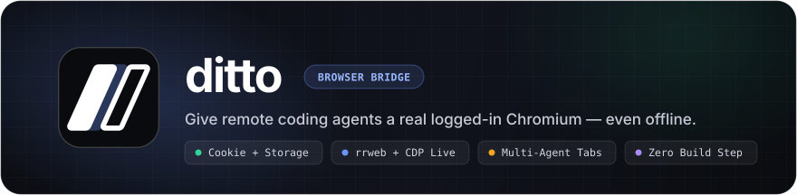
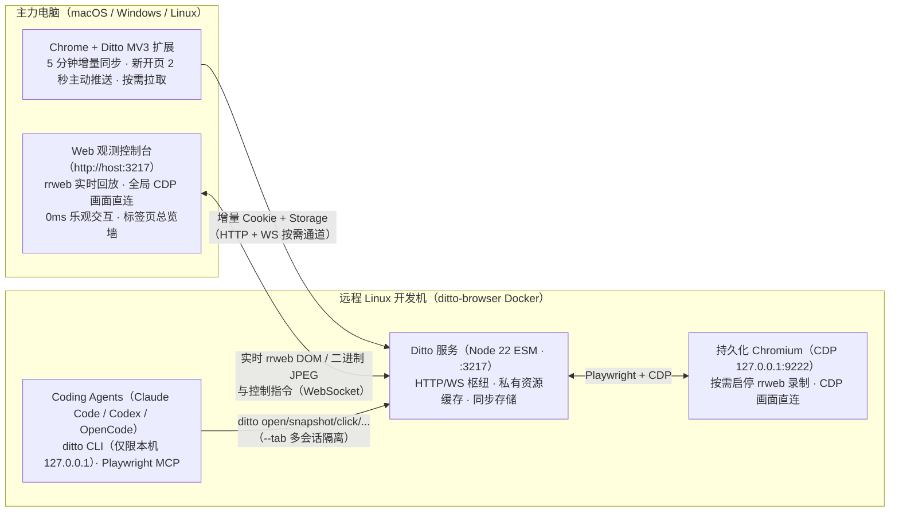

<p align="center">
  
</p>

<p align="center">
  <strong>让远程 Linux 开发机上的 Coding Agent 拥有真实已登录的 Chromium —— 即使主力电脑合盖离线也能持续工作。</strong>
</p>

<p align="center">
  <a href="./README.md">English</a> · <a href="./README.zh-CN.md"><strong>简体中文</strong></a>
</p>

<p align="center">
  <a href="https://github.com/zonghow/Ditto/actions/workflows/ci.yml"></a>
  = 22" />
  
  
  
  <a href="./LICENSE"></a>
</p>

---

## 为什么做 Ditto？

在无桌面 Linux 开发机或云服务器上运行 Coding Agent（**Claude Code**、**Codex**、**OpenCode** 等）时，一旦需要操作已登录的网页（内部控制台、PR 评审、测试环境后台、SaaS 平台），常见方案往往两难：

- **普通无头浏览器没有登录态** —— 面对 SSO、Cookie 鉴权和二次验证寸步难行。
- **桥接主力机本地 Chrome 会抢焦点且断连即死** —— 主力电脑合盖休眠，开发机上的 Agent 立刻卡死。

**Ditto** 在远程 Linux 上以 Docker 运行一个独立持久化的 Chromium，通过主力机上的零构建 Chrome MV3 扩展**自动增量同步真实登录态（Cookie + `localStorage` / `sessionStorage`）**，对外提供支持多 Agent 并发隔离的 `ditto` CLI 与 Skill，并自带类 Chrome 体验的 Web 实时观测控制台（轻量 `rrweb` DOM 回放 + 全局 CDP 画面直连），随时查看进度或人工介入过验证码。

| 能力对比 | **Ditto** | 本地 Chrome MCP / 桥接 | 普通无头 Playwright | noVNC / 远程桌面 |
| --- | :---: | :---: | :---: | :---: |
| 主力电脑合盖离线后继续工作 | **支持** | 不支持 | 支持 | 支持 |
| 自动复用主力机真实 Chrome 登录态 | **支持** | 支持 | 不支持 | 需手动重登 |
| 不抢占主力机窗口焦点 | **支持** | 会抢焦点 | 支持 | 支持 |
| 多 Agent 并发标签页隔离（`--tab`） | **支持** | 不支持 | 需自行维护 | 不支持 |
| 轻量实时 DOM 回放（空闲约 `0.3 KB/s`） | **支持** | 不适用 | 不支持 | 不支持（高带宽视频） |
| 跨域登录框 / Canvas 验证码 / 滑块直连 | **支持** | 支持 | 不支持 | 支持 |
| 零构建步骤（Node 22 ESM + 原生浏览器 ESM） | **支持** | 视项目而定 | 视项目而定 | 不支持 |

---

## 系统架构



---

## 核心特性

- **离线可用的自动登录态同步**
  - 扩展连线后立刻执行一次全量 Cookie + 已开页 Storage 同步，后台每 **5 分钟**基于 SHA-256 指纹增量去重同步，主力机新开标签页 **2 秒内**主动推送，并支持远端 `ditto sync` 按需拉取。
  - 完整保留 `HttpOnly`、`Secure`、`SameSite`、过期时间、host-only 边界与分区键；主力机关机后远端 Chromium Profile 内登录态依然持久化有效。
- **多 Agent 并发安全的 `ditto` CLI & Skill**
  - 零依赖命令行工具 `~/.local/bin/ditto` 与开箱即用的 `skills/ditto/SKILL.md`（自动软链至 Claude Code / Codex / OpenCode）。
  - 遵循「一人一 Tab，全程带 `--tab`」与会话自动绑定机制，多个并发 Agent 互不串台、互不抢焦点。
  - 支持 Shadow DOM 与同源 iframe 快照（`@e1`、`@e2` 引用）、点击、填写、下拉选择、滚动、文件上传、原生弹窗处理、控制台/网络排障、JS 执行与截图。
- **低延迟类 Chrome Web 观测控制台**
  - **熟悉的操作手感**：横向/竖向标签栏（读取真实 CDP 标签顺序）、点击左上角 Ditto Logo 一键切换自适应全屏「全部标签页总览」、标签右键菜单、融合远端与本机 Chrome 历史的地址栏自动补全。
  - **0ms 乐观更新与全链路提速**：本地 0ms 乐观滚动（稳态防抖校准）、乐观开关标签页（遇到 `beforeunload` 无感回滚）、乐观原生表单控件（Checkbox / Radio / `<select>` / `<details>`）、`:active` 按压触感反馈，以及交互期间服务端 0ms 即时 flush。
  - **右侧设置抽屉**（点击标签栏最右侧 ⚙ 齿轮呼出）：视图切换、横/竖向标签栏、深/浅/跟随系统主题、自适应 / 1080p 视口、**全局画面直连开关**、活跃 Agent 锁定跟随、实时进程 PSS 内存明细与远端下载文件拉回。
- **全局画面直连模式（CDP Screencast）**
  - 在右侧抽屉打开「画面直连」Switch 即可全局生效（切标签、新建页导航、重连自动无缝衔接），通过二进制 WebSocket 帧 + `createImageBitmap` 异步解码 + 背压丢帧流畅传输。
  - 原生支持跨域 SSO 登录框、Canvas 验证码点击与滑块拖拽；直连期间自动暂停 `rrweb` 录制，零多余开销。
- **安全边界内置**
  - `rrweb` 回放 iframe 严格锁定 `sandbox="allow-same-origin"`（不启用 `allow-scripts`）、服务端剥离脚本并注入 CSP、密码字段脱敏、`[data-ditto-private]` 区域阻断、免鉴权模式下 `/api/agent/*` 仅允许本机 `127.0.0.1` 访问。详见 [SECURITY.md](./SECURITY.md)。

---

## 3 步快速上手

### 第 1 步：在主力电脑加载 Chrome 扩展

1. 打开主力电脑 Chrome 的 `chrome://extensions/`。
2. 打开右上角「**开发者模式**」，点击「**加载已解压的扩展程序**」。
3. 选择本仓库的 **`extension/`** 目录（无需任何构建），保持网站访问权限开启。

### 第 2 步：在远程 Linux 开发机部署 Ditto

#### 方式 A：让开发机上的 Agent 一键完成（推荐）

把下面这句话直接发给运行在开发机上的 **Claude Code / Codex / OpenCode**：

```text
请先将 https://github.com/zonghow/Ditto.git 克隆到 ~/Ditto（若已存在则直接进入），然后按照其中的 INSTALL.md 通过 Docker 部署 Ditto 服务、安装 ditto CLI 与浏览器 Skill，验证 /health 就绪后把连接地址发给我。
```

#### 方式 B：手动 Docker 一键启动

```bash
git clone https://github.com/zonghow/Ditto.git
cd Ditto
sh scripts/docker-up.sh        # 构建并后台启动 ditto-browser（监听 3217）
sh scripts/install-skill.sh    # 安装 ~/.local/bin/ditto 与 Agent Skill
ditto status                   # 验证 Chromium 就绪
```

> 如拉取海外软件源较慢，可指定国内镜像源加速：
> `DITTO_APT_MIRROR=http://mirrors.tuna.tsinghua.edu.cn DITTO_NPM_REGISTRY=https://registry.npmmirror.com sh scripts/docker-up.sh`
>
> 如需 SSH 隧道模式、开启 `DITTO_AUTH=1` 鉴权、兼容旧版 Docker 18、连接 Playwright MCP 或使用 CookieCloud，请查看 [docs/deployment.md](./docs/deployment.md)。

### 第 3 步：插件填入地址连接

1. 点击主力电脑 Chrome 工具栏的 **Ditto** 图标，填入 `http://<开发机IP>:3217`，点击「**连接**」。
2. 连接成功后立即在后台运行全量增量同步。
3. 点击插件右上角「**观测页 ↗**」（或直接打开 `http://<开发机IP>:3217`），即可随时实时观看或直接操控开发机浏览器。

---

## `ditto` CLI 常用命令

完整 Agent 使用规范见 [skills/ditto/SKILL.md](./skills/ditto/SKILL.md)。

```bash
# 打开专属标签页（扩展在线时自动同步登录态），返回 shortId（如 e28c2282）
ditto open "https://example.com"

# 查看页面结构与交互操作（并发多 Agent 始终携带 --tab <shortId>）
ditto snapshot --tab e28c2282             # 提取文本与元素引用（@e1/@e2，支持 Shadow DOM / 同源 iframe）
ditto click @e1 --tab e28c2282            # 按引用或 Playwright 选择器点击
ditto fill @e2 "文本内容" --tab e28c2282  # 填写输入框
ditto select @e3 "opt" --tab e28c2282     # 选择下拉选项
ditto press Enter --tab e28c2282          # 发送键盘按键
ditto scroll down --tab e28c2282          # 滚动页面或指定容器（--target）
ditto upload @e4 /path/file.png --tab e28c2282
ditto wait --text "完成" --tab e28c2282   # 等待元素 / 文本 / URL / --networkidle

# 排障、弹窗与收尾
ditto dialog accept --tab e28c2282        # 处理原生 alert / confirm / prompt 弹窗
ditto console --tab e28c2282              # 查看控制台日志与未捕获异常
ditto network --tab e28c2282              # 查看失败请求（加 --all 查看全部）
ditto eval "document.title" --tab e28c2282
ditto sync --tab e28c2282                 # 强制从主力机重新同步登录态并刷新
ditto screenshot /tmp/page.png --tab e28c2282
ditto close --tab e28c2282
```

---

## 项目结构

```text
Ditto/
├── src/                  # Node.js 22 ESM 服务端（Express + ws + Playwright + CDP）
│   ├── main.js           # 服务入口与优雅退出
│   ├── app.js            # HTTP 路由、静态资源 ETag 缓存与中间件
│   ├── ws-hub.js         # 观测页与扩展 WebSocket 枢纽、二进制直连帧分发
│   ├── browser*.js       # 持久化 Chromium 生命周期、CDP 操控、按需录制与标签管理
│   ├── recorder*.js      # 页面注入 rrweb 2.2 录制器与严格 DOM 净化器
│   ├── screencast.js     # CDP Page.startScreencast 会话管理
│   ├── import-snapshot.js# SHA-256 指纹增量 Cookie / Storage 导入器
│   └── routes/           # /api/agent/*（本机回环保护）与 /api/sync/* 路由
├── public/               # 零构建浏览器 ESM 观测控制台（标签栏、总览墙、回放器、右侧抽屉）
├── extension/            # Chrome MV3 扩展（定时增量同步 + 新开页主动推送）
├── scripts/              # 零依赖 `ditto` CLI、Docker 与 SSH 部署脚本
├── skills/ditto/         # 开箱即用的 Coding Agent SKILL.md
├── deploy/               # 旧版 Docker 18 兼容 Dockerfile、安装脚本与 seccomp 配置
├── docs/                 # 部署运维文档与视觉资源
└── test/                 # 99 项单元测试 + 真实 Chromium / 附着模式 / MV3 扩展集成测试
```

---

## 本地开发与测试

需要 **Node.js 22+**。

```bash
npm ci --ignore-scripts
npx playwright install chromium

npm test                  # 99 项单元测试（无需启动 Chromium）
npm run test:integration  # 真实 Chromium + Web 控制台 + rrweb + UI 全链路集成测试
npm run test:attach       # 附着伴随进程模式集成测试
npm run test:extension    # Chrome MV3 扩展真实侧载与自动同步集成测试
npm start                 # 本地启动（http://127.0.0.1:3217）
```

更多细节请参阅 [CONTRIBUTING.md](./CONTRIBUTING.md)（贡献指南）、[docs/deployment.md](./docs/deployment.md)（进阶部署与环境变量）与 [SECURITY.md](./SECURITY.md)（安全模型）。

---

## 致谢

本项目基于 [Playwright](https://playwright.dev/)、[Playwright MCP](https://github.com/microsoft/playwright-mcp) 与 [rrweb](https://www.rrweb.io/) 构建，同步兼容协议参考了 [CookieCloud](https://github.com/easychen/CookieCloud)。

## 开源协议

[MIT](./LICENSE) © 2026 zonghow
